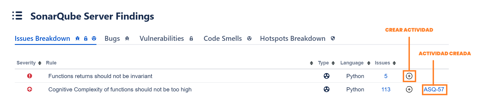
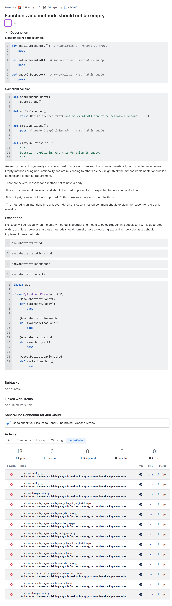

Si trabajas con **SonarQube y Jira**, probablemente conozcas esta situación: terminas un análisis de código, detectas problemas que debes corregir y necesitas trasladar esa información a Jira para organizar el trabajo del equipo.

Copiar manualmente las reglas incumplidas, las descripciones, las evidencias y los enlaces al código consume tiempo y aumenta el riesgo de cometer errores.

Pero ¿y si pudieras **crear tareas en Jira directamente a partir de los resultados de SonarQube**, sin tener que copiar toda esa información?

Con **SonarQube Connector for Jira**, la aplicación desarrollada por excentia, puedes consultar los resultados del análisis de SonarQube desde Jira y crear tareas con la información necesaria para gestionar los problemas detectados.

<h2>¿Cómo integrar SonarQube con Jira?</h2>

**SonarQube Connector for Jira** es una aplicación que integra los resultados de los análisis de **SonarQube Server y SonarQube Cloud** en proyectos de Jira.

Esta integración permite a los equipos de desarrollo consultar información sobre la calidad y seguridad del código, revisar el estado de los Quality Gates y gestionar los problemas detectados sin tener que cambiar continuamente de herramienta.

La aplicación está disponible en el [Atlassian Marketplace](https://www.excentia.es/sonarqube-connector-jira).

Una de sus funcionalidades más útiles es la posibilidad de **crear tareas en Jira a partir de reglas incumplidas detectadas por SonarQube**.

<h2>Cómo crear tareas en Jira desde SonarQube paso a paso</h2>

Una vez configurada la integración, puedes crear tareas en Jira siguiendo estos pasos:

### 1. Consulta los resultados del análisis de SonarQube

Accede al proyecto de Jira vinculado con SonarQube y consulta los resultados del análisis de código.

Desde la aplicación puedes revisar las reglas incumplidas y las evidencias asociadas.

### 2. Selecciona la regla que quieres gestionar

Localiza la regla incumplida para la que necesitas crear una tarea y pulsa el botón **+**.

  

### 3. Crea la tarea con la información de SonarQube

La aplicación permite crear una tarea de Jira incorporando información relacionada con la regla seleccionada y sus evidencias.

Entre los datos que puedes consultar se encuentran:

- **Nombre de la regla incumplida:** utilizado como resumen de la tarea de Jira.
- **Descripción de la regla:** información sobre el problema detectado.
- **Información de la solución:** recomendaciones disponibles para resolver el problema.
- **Excepciones:** cuando corresponda.
- **Evidencias asociadas:** información de los problemas detectados y enlaces a las líneas de código correspondientes.

De esta forma, el equipo dispone de información relevante para analizar y resolver el problema sin tener que recopilarla manualmente.

Este es un ejemplo de una tarea creada con SonarQube Connector for Jira:

  

### 4. Prioriza y asigna la tarea

Una vez creada, puedes **priorizar la tarea en el backlog, asignarla a un desarrollador o incorporarla a un sprint**, siguiendo el flujo de trabajo habitual de tu equipo.

Así puedes gestionar los problemas de calidad del código desde Jira y mantener la información técnica vinculada a las tareas de desarrollo.

<h2>Ventajas de integrar SonarQube con Jira</h2>

Integrar ambas herramientas ayuda a reducir las tareas manuales y facilita la colaboración entre desarrolladores, tech leads y responsables de calidad.

Estas son algunas de sus principales ventajas:

- **Ahorro de tiempo:** evita copiar manualmente información entre SonarQube y Jira.
- **Mayor contexto:** las tareas incluyen información técnica relacionada con los problemas detectados.
- **Mejor planificación:** los tech leads pueden organizar y priorizar las correcciones dentro de Jira.
- **Menos errores manuales:** reduce el riesgo de omitir información al trasladar las evidencias.
- **Seguimiento centralizado:** facilita la gestión de los problemas de calidad del código dentro del flujo de trabajo del equipo.

El resultado es un proceso más sencillo para incorporar las correcciones de código al trabajo diario.

<h2>Preguntas frecuentes sobre la integración de SonarQube con Jira</h2>

### ¿Se puede integrar SonarQube Cloud con Jira?

Sí. SonarQube Connector for Jira permite consultar resultados de SonarQube Cloud desde Jira y trabajar con la información de los análisis de código.

### ¿Funciona también con SonarQube Server?

Sí. La aplicación permite integrar proyectos de SonarQube Server y SonarQube Cloud con Jira.

### ¿Qué información se incluye al crear una tarea?

La tarea puede incorporar información de la regla incumplida, su descripción y las evidencias asociadas, incluyendo referencias al código afectado.

### ¿Es necesario copiar manualmente las issues de SonarQube?

No. La aplicación permite crear tareas de Jira a partir de las reglas incumplidas y consultar sus evidencias sin tener que copiar manualmente toda la información.

### ¿Cuánto cuesta SonarQube Connector for Jira?

El precio depende de la modalidad de Jira y del número de usuarios. Puedes consultar las condiciones y los precios actualizados en el [Atlassian Marketplace](https://marketplace.atlassian.com/apps/1217471/sonarqube-connector-for-jira?tab=pricing).

<h2>Vídeo: cómo crear una tarea de Jira desde SonarQube</h2>

En este vídeo puedes ver cómo utilizar SonarQube Connector for Jira para crear una tarea a partir de los resultados de un análisis de SonarQube.

  <iframe
    width="660"
    height="415"
    style="max-width: 100%;"
    src="https://www.youtube.com/embed/3YXbauc0zuY"
    title="Cómo crear una tarea en Jira desde SonarQube con SonarQube Connector for Jira"
    loading="lazy"
    allow="accelerometer; autoplay; clipboard-write; encrypted-media; gyroscope; picture-in-picture; web-share"
    referrerpolicy="strict-origin-when-cross-origin"
    allowfullscreen>
  </iframe>

<h2>Empieza a gestionar la calidad del código desde Jira</h2>

Integrar SonarQube con Jira permite conectar los resultados del análisis de código con las tareas que gestiona tu equipo.

Con **SonarQube Connector for Jira** puedes consultar la calidad del código, revisar las reglas incumplidas y crear tareas con información técnica para organizar las correcciones.

**[Descubre SonarQube Connector for Jira en el Atlassian Marketplace](https://marketplace.atlassian.com/apps/1217471/sonarqube-connector-for-jira)** y simplifica la gestión de los problemas de calidad del código.
