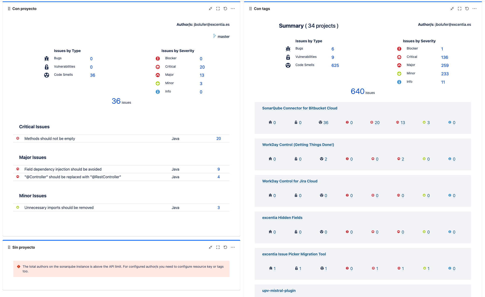
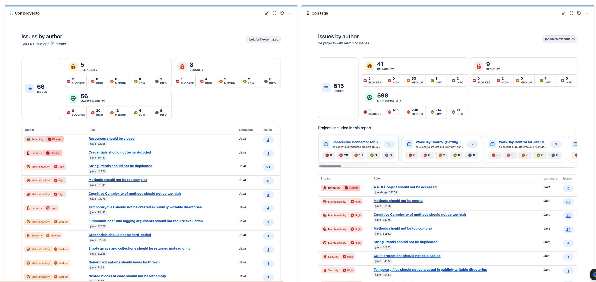

<strong>SonarQube Connector for Jira 5.0 ya está disponible.</strong> Esta nueva versión incorpora mejoras en los dos gadgets de Jira que ofrece la aplicación, con compatibilidad con el modo MQR (Multi-Quality Rule) de SonarQube y un diseño renovado para la visualización de issues por autor.

El objetivo de esta actualización es facilitar el acceso a la información sobre la <strong>calidad y seguridad del código directamente desde los dashboards de Jira</strong>, sin necesidad de cambiar constantemente entre herramientas.

<h2>¿Qué novedades incorpora SonarQube Connector for Jira 5.0?</h2>

SonarQube Connector for Jira 5.0 actualiza sus dos gadgets con compatibilidad MQR. Además, renueva el diseño del gadget de issues por autor y corrige errores de funcionamiento. La versión 5.0 se centra en mejorar la experiencia de los usuarios que consultan métricas de SonarQube desde Jira. Entre las principales novedades destacan:

- <strong>Compatibilidad con el modo MQR de SonarQube</strong> en los dos gadgets de la aplicación.
- <strong>Visualización de métricas de SonarQube en los dashboards de Jira</strong>, con la misma información disponible en el panel integrado de los proyectos.
- <strong>Rediseño visual del gadget de issues por autor</strong>, para mejorar la presentación de los resultados.

Estas mejoras continúan la evolución de la aplicación. Si quieres conocer las funcionalidades de versiones anteriores, puedes consultar las <a href="https://www.excentia.es/lanzamiento-sonarqube-connector-jira-4-0">novedades de SonarQube Connector for Jira 4.0</a>.

A continuación, repasamos las mejoras de cada gadget.

<h2>Gadget de métricas de SonarQube: consulta la calidad del código desde Jira</h2>

Uno de los gadgets disponibles en SonarQube Connector for Jira permite <strong>mostrar en un dashboard de Jira la misma información que ofrece el panel de SonarQube integrado dentro de los proyectos de Jira</strong>.

Esta funcionalidad permite consultar los resultados del análisis de código desde un dashboard, sin necesidad de acceder individualmente a cada proyecto para revisar su información.

Con la versión 5.0, este gadget incorpora <strong>compatibilidad con el modo MQR de SonarQube</strong>.

<h3>¿Qué ventajas ofrece este gadget?</h3>

Los dashboards de Jira permiten reunir información relevante para el seguimiento de los proyectos. Gracias a este gadget, los equipos pueden incorporar información de SonarQube a sus paneles de trabajo habituales.

Esto facilita:

- Consultar información sobre la calidad del código desde los dashboards de Jira.
- Centralizar la información de SonarQube y Jira en un mismo espacio.
- Facilitar el seguimiento de los análisis de código.
- Compartir la información con otros miembros del equipo que utilizan Jira.

<h2>Gadget de issues por autor: nuevo diseño y compatibilidad con MQR</h2>

La segunda gran mejora de <strong>SonarQube Connector for Jira 5.0</strong> afecta al gadget que permite visualizar las issues de SonarQube asociadas a uno o varios autores. Este gadget resulta especialmente útil para los equipos que necesitan consultar las incidencias detectadas durante los análisis de código y organizarlas en función de sus autores.

En esta nueva versión se han incorporado tres mejoras importantes.

<h3>1. Compatibilidad con el modo MQR de SonarQube</h3>

El gadget de issues por autor se ha actualizado para ofrecer <strong>compatibilidad con el modo MQR (Multi-Quality Rule) de SonarQube</strong>. Esta mejora permite adaptar la visualización de las issues al modelo MQR, que clasifica los problemas de acuerdo con sus impactos sobre distintas características de calidad del software.

De esta forma, los usuarios que trabajan con este modelo pueden consultar la información desde Jira.

<h3>2. Nuevo diseño para visualizar las issues por autor</h3>

Además de la compatibilidad con MQR, se ha realizado un <strong>rediseño visual del gadget de issues por autor</strong>. Esta actualización mejora la presentación de la información y renueva la interfaz utilizada para consultar las incidencias asociadas a uno o varios autores. Para apreciar la evolución del gadget, comparamos su aspecto anterior con el nuevo diseño incorporado en la versión 5.0.

<strong>Antes: diseño anterior del gadget de issues por autor</strong>

 

<strong>Ahora: nuevo diseño del gadget de issues por autor en la versión 5.0</strong>

 

La nueva interfaz ofrece una presentación renovada para consultar las issues de SonarQube desde los dashboards de Jira.

<h2>¿Por qué integrar SonarQube con Jira?</h2>

Integrar SonarQube con Jira permite a los equipos de desarrollo consultar información sobre la calidad del código desde la herramienta que utilizan habitualmente para gestionar sus proyectos. Además de visualizar métricas e incidencias mediante gadgets, la integración entre ambas herramientas facilita el seguimiento de los problemas detectados durante los análisis.

Si quieres conocer otras ventajas de esta integración, descubre <a href="https://www.excentia.es/como-ahorrar-tiempo-entre-sonarqube-jira">cómo ahorrar tiempo entre SonarQube y Jira</a> y simplificar la gestión de las incidencias de calidad del código.

<h2>Descarga SonarQube Connector for Jira 5.0</h2>

<strong>La versión 5.0 de SonarQube Connector for Jira ya está disponible.</strong>

Si utilizas Jira y SonarQube, actualiza la aplicación para aprovechar la compatibilidad con MQR, el nuevo diseño del gadget de issues por autor y las correcciones incorporadas.

<a href="https://marketplace.atlassian.com/apps/1217471/sonarqube" target="_blank"><strong>Descargar SonarQube Connector for Jira en Atlassian Marketplace</strong></a>

Si quieres conocer más detalles sobre la configuración y el funcionamiento de la aplicación, puedes consultar nuestra <a href="https://www.excentia.es/docs/sonarqube-connector-for-jira"><strong>documentación técnica de SonarQube Connector for Jira</strong></a>.

Con SonarQube Connector for Jira 5.0 seguimos mejorando la integración entre ambas herramientas para que los equipos puedan consultar la información sobre calidad y seguridad del código desde sus espacios de trabajo habituales.
